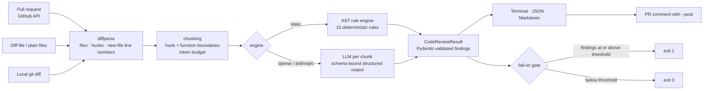
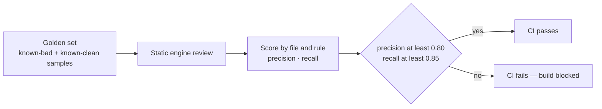

# DiffSentry

**AI-powered code review for diffs and pull requests — infrastructure, not a script.**

    [](https://github.com/Sravanthipanga/diffsentry/actions/workflows/ci.yml)

```console
$ diffsentry review --pr 142 --repo you/your-project

■ HIGH    —  security/auth.py:47   [security · sql-string-concat]
  SQL query built by string concatenation → use parameterized queries.
● MEDIUM  —  api/users.py:89       [error-handling · missing-error-handling]
  requests.get call has no surrounding try/except.
✓ LOW     —  utils/parser.py:12    [performance · regex-in-loop]
  re.compile runs on every iteration → compile once at module level.

3 issues · 1 high · 1 medium · 1 low · 0.8s
```

DiffSentry reviews a diff and returns **structured findings only** — every
issue is a Pydantic-validated `ReviewIssue` with a severity, a category, an
exact `file:line`, an explanation, and a suggested fix. There is no free-form
review text anywhere in the system.

## Architecture



Every input path converges on the same pipeline, every engine returns the
same schema, and the exit code is a pure function of the findings — which is
what lets one command serve as a local tool, a CI gate, and a GitHub Action.

## The three hard problems, handled

1. **Large diffs > context window.** Chunking is structure-aware: diffs are
   split at hunk and function/class boundaries and packed under a token
   budget (`--max-tokens`), never sliced mid-function by naive line counts.
   Only a single function larger than the whole budget is hard-split.
2. **Reliable structured output.** The LLM engines are schema-bound:
   OpenAI is called with a JSON-Schema `response_format` generated from the
   Pydantic model, Anthropic with a forced tool whose `input_schema` is the
   same model. Output is validated with `model_validate`; a validation
   failure is fed back for one repair retry. Zero regex scraping of prose.

   ```mermaid
   flowchart TD
       C["Diff chunk"] --> M["Model call<br/>JSON Schema / forced tool"]
       M --> V{"Pydantic validation"}
       V -->|valid| OK["ReviewIssue list"]
       V -->|invalid, first time| F["Feed the validation error back"]
       F --> M
       V -->|invalid, second time| FAIL["Fail loudly<br/>no prose ever ships"]
   ```
3. **Measurable quality.** A golden set of known-bad and known-clean code
   (`eval/`) is scored for **precision and recall** and gated in CI
   (precision ≥ 0.80, recall ≥ 0.85). Current: **1.00 / 1.00**.

## Engines

| Engine | Needs | Behaviour |
|---|---|---|
| `static` (default) | nothing | Deterministic AST + line rules — same diff in, same review out. Runs offline, in CI, and in the eval harness. |
| `openai` | `OPENAI_API_KEY` | GPT structured-output review per chunk, plus the static engine's diff-level checks. |
| `anthropic` | `ANTHROPIC_API_KEY` | Claude forced-tool review per chunk, plus the static checks. |

The static engine enforces 15 rules across security (SQL string concat,
hardcoded secrets, `eval`/`exec`, unsafe deserialization, shell injection,
weak hashes), error handling (missing try/except around HTTP calls, bare
`except:`, swallowed exceptions), performance (queries and regex compiles in
loops, `+=` accumulation in loops), correctness (mutable default args,
`assert` in production), and test coverage (new code landing with no test
changes in the diff). Run `diffsentry rules` for the list.

## Usage

```console
diffsentry review --pr 142 --repo owner/name      # a GitHub PR (GITHUB_TOKEN)
diffsentry review --diff changes.patch            # a unified diff file
diffsentry review --files src/auth.py src/api.py  # plain files, as additions
diffsentry review                                  # your unstaged git diff
diffsentry review --staged                         # your staged git diff
```

Options: `--engine`, `--format terminal|json|markdown`, `--output FILE`,
`--post` (comment the review on the PR), and `--fail-on high|medium|low|never`
— the exit code is 1 when any finding meets the threshold, so the same
command is a local tool and a CI gate.

## GitHub Actions

Use it as an action — it reviews every PR, posts the findings as a comment,
and fails the check on high-severity issues:

```yaml
# .github/workflows/diffsentry-review.yml
on: pull_request
permissions:
  contents: read
  pull-requests: write
  issues: write
jobs:
  review:
    runs-on: ubuntu-latest
    steps:
      - uses: actions/checkout@v4
      - uses: Sravanthipanga/diffsentry@v1
        with:
          engine: static        # or openai / anthropic with the key as an env
          fail-on: high
```

This repo dogfoods it: `.github/workflows/diffsentry-review.yml` reviews
DiffSentry's own PRs with the local action. A composite `action.yml` is at
the repo root.

## Evaluation



```console
python eval/run_eval.py   # writes eval/report.json, exits 1 on gate failure
```

Cases live in `eval/cases.json`; samples in `eval/samples/` — four known-bad
files (each rule must fire), one clean file (nothing may fire), and one
clean-but-untested feature (only the missing-tests rule may fire).

## Development

```console
pip install -e ".[dev]"
pytest -q
```

## License

MIT License — see [LICENSE](LICENSE). © 2026 Sravanthi Panga.
